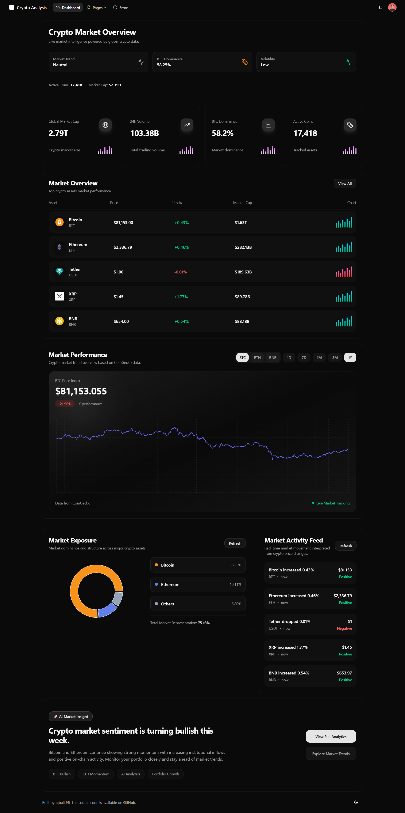
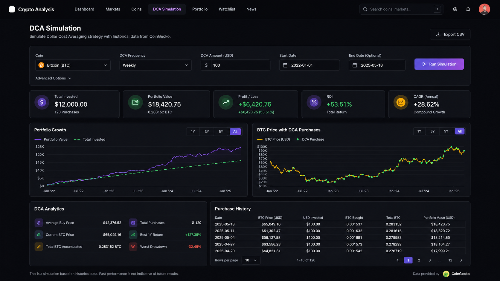

# 📊 Crypto Analytics

Dashboard analitik cryptocurrency berbasis React + Vite dengan arsitektur **feature-based**. Terdiri dari dua fitur utama:

- **Dashboard** — ringkasan pasar crypto dari CoinGecko.
- **DCA Simulation** — simulasi *Dollar Cost Averaging* menggunakan harga historis (BTC, ETH, SOL).

## 📸 Screenshot

**Dashboard**



**DCA Simulation**



---

## 🚀 Tech Stack

| Kebutuhan | Library |
|---|---|
| Framework & build | React 19, Vite 6, TypeScript |
| Routing | React Router 7 |
| Data fetching & cache | TanStack Query 5, Axios |
| Form & validasi | React Hook Form, Zod 4 |
| UI | Tailwind CSS 4, shadcn/ui (Radix), Lucide Icons |
| Grafik & animasi | Recharts, Framer Motion |
| Tanggal | date-fns |

---

## ⚙️ Menjalankan Project

```bash
# 1. Install dependency
pnpm install

# 2. Salin file environment
cp .env.example .env

# 3. Jalankan development server
npm run dev
```

### Environment Variables

| Variable | Keterangan | Contoh |
|---|---|---|
| `VITE_COINGECKO_API_URL` | Base URL CoinGecko API (wajib) | `https://api.coingecko.com/api/v3` |
| `VITE_APP_NAME` | Nama aplikasi | `Crypto Analytics` |
| `VITE_BASE_URL` | Base path saat deploy di sub-folder | *(kosong)* |
| `VITE_USE_HASH_ROUTE` | `true` untuk memakai `HashRouter` | `false` |

> Semua variable `VITE_*` ikut masuk ke bundle frontend dan terlihat di browser. Jangan simpan secret di sini.

### Script

| Perintah | Fungsi |
|---|---|
| `npm run dev` | Development server |
| `npm run build` | Type-check (`tsc -b`) lalu build produksi |
| `npm run preview` | Preview hasil build |
| `npm run lint` | Jalankan ESLint |
| `npm run build:gh` | Build untuk GitHub Pages (base path `/react-crypto-dashboard/`, hash router) |

---

## 🧠 Arsitektur

Pemisahan layer:

- **Feature layer** — komponen, hook, service, dan tipe per domain.
- **Engine** — logika bisnis murni (tanpa React) yang mudah dites.
- **Service layer** — akses API (Axios).
- **Hook layer** — abstraksi data fetching dengan TanStack Query.
- **Shared layer** — UI, utilitas, dan HTTP client yang dipakai lintas fitur.

```txt
src/
├── app/                      # App root, router, provider (React Query)
├── config/                   # Konfigurasi app & menu sidebar
├── contexts/                 # ThemeContext
├── lib/                      # utils (cn)
├── features/
│   ├── dashboard/
│   │   ├── components/
│   │   ├── derived/          # data turunan dari query dasar
│   │   ├── hooks/
│   │   ├── pages/
│   │   ├── services/
│   │   └── types/
│   ├── dca-simulation/
│   │   ├── components/       # controls, summary cards, grafik, tabel, analytics
│   │   ├── constants/        # daftar aset yang didukung
│   │   ├── engine/           # logika simulasi DCA (pure functions)
│   │   ├── hooks/            # use-historical-data, use-dca-simulation
│   │   ├── pages/
│   │   ├── services/         # request ke CoinGecko
│   │   ├── types/
│   │   └── utils/            # format angka, helper aset
│   └── not-match/
├── shared/
│   ├── components/           # layout, header, sidebar, shadcn/ui
│   ├── hooks/
│   ├── services/             # api.ts, http-client.ts, interceptors.ts
│   └── utils/                # format currency, persen, market cap
└── styles/
```

### Alur Data

```txt
UI → Hook → TanStack Query → Service → HTTP Client (Axios) → CoinGecko API
                                                              │
UI ← Engine (simulasi) ← Hook ← Cache (TanStack Query) ←──────┘
```

---

## 💰 DCA Simulation

Simulasi membeli aset dengan nominal tetap secara berkala pada rentang tanggal historis.

### Input

| Field | Aturan |
|---|---|
| Asset | Bitcoin, Ethereum, atau Solana |
| Investment Amount | USD per pembelian, harus > 0 |
| Start / End Date | Tidak boleh di masa depan, start < end, maksimal 365 hari |
| Interval | Daily (1), Weekly (7), atau Monthly (30 hari) |

### Cara Kerja Engine

Semua ada di `src/features/dca-simulation/engine/`:

| File | Tugas |
|---|---|
| `generate-investment-schedule.ts` | Membuat jadwal pembelian tiap `intervalDays` hari, dari titik data pertama sampai terakhir |
| `find-nearest-price.ts` | Mencari harga terdekat untuk setiap tanggal jadwal |
| `calculate-investment-event.ts` | Menghitung unit aset yang dibeli pada satu pembelian |
| `build-simulation-timeline.ts` | Membuat deret harian: harga, total investasi, total unit, nilai portofolio |
| `build-simulation-summary.ts` | Menyusun ringkasan hasil |
| `run-dca-simulation.ts` | Merangkai seluruh langkah di atas |

### Rumus

```txt
unit dibeli          = nominal / harga saat beli
total investasi      = Σ nominal
total unit           = Σ unit dibeli
nilai portofolio     = total unit × harga terakhir
profit / loss        = nilai portofolio − total investasi
return (%)           = profit / total investasi × 100
harga beli rata-rata = total investasi / total unit
rata-rata vs sekarang (%) = (harga beli rata-rata − harga terakhir) / harga terakhir × 100
```

### Sumber Data

Harga diambil dari endpoint `GET /coins/{id}/market_chart/range` (`vs_currency=usd`, `interval=daily`) dengan `from` dan `to` dari tanggal yang dipilih. Hanya satu titik per hari (UTC) yang dipakai.

### Keterbatasan

- Memakai **CoinGecko API gratis**: ada rate limit, dan data historis dibatasi sekitar 365 hari ke belakang.
- Harga yang dipakai adalah harga harian (00:00 UTC), bukan harga intraday.
- Simulasi tidak memperhitungkan biaya transaksi, slippage, atau pajak.
- *Best Return* dan *Worst Return* adalah return tertinggi dan terendah terhadap total investasi selama periode, bukan *max drawdown*.
- Hasil simulasi historis bukan jaminan performa di masa depan, dan bukan saran investasi.

---

## 🔑 Prinsip

- Separation of concerns
- Service layer pattern
- Feature isolation
- Logika bisnis dipisah dari UI (engine murni)
- Caching dengan TanStack Query (`staleTime` 5 menit untuk data historis)

---

## 🧩 Rencana Pengembangan

- Unit test untuk engine DCA
- WebSocket real-time data
- Candlestick chart
- Portfolio tracking
- Indikator lanjutan (mis. max drawdown)
